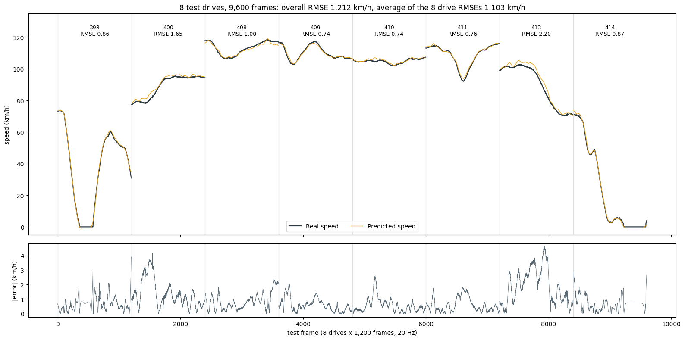

# Vehicle speed estimation from dashcam images

Predicting a car's speed (km/h) for every frame using **camera images only**: no GPS, wheel speed or IMU input.
Built for a deep learning course project on a subset of the [comma2k19](https://github.com/commaai/comma2k19) driving dataset.

**Test result: RMSE 1.212 km/h over all 9,600 test frames** (average of the 8 per-drive RMSEs 1.103 km/h, MAE 0.90 km/h).



## Task

| Split | Drives | Frames |
|---|---|---|
| Train | 60 | 72,000 |
| Validation | 8 | 9,600 |
| Test (held out) | 8 | 9,600 |

Each drive is 1,200 consecutive 1164 x 874 frames at 20 Hz. Train and validation drives (68 in total) were used for
development with 3-fold drive-level cross-validation; the test drives were only used for evaluation.

## Approach

Speed is motion, so each model sees a short clip rather than a single frame. Two CNN branches look at the same frames
in two different views, and their predictions are blended by speed:

| | Top-down branch | Front-view branch |
|---|---|---|
| View | Road warped to a 192 x 96 bird's-eye view, where road texture moves at a rate set by speed | Whole frame resized to 144 x 256, greyscale |
| Input tensor | 17 RGB frames (t-8 ... t+8) stacked: **51 x 192 x 96** | 5 frames 0.1 s apart + 5 frame differences: **10 x 144 x 256** |
| Backbone | ConvNeXt-Tiny (ImageNet-1k), stem widened to 51 channels | ConvNeXt-Nano (ImageNet-12k), stem adapted to 10 channels |
| Feature map after stage 4 | 768 x 6 x 3 | 640 x 4 x 8 |
| Parameters | 27.9 M | 15.0 M |
| Key augmentation | Speed augmentation: every 2nd frame with the label doubled | Time stretch (frame gap 1-4, label scaled), flip, shift |
| Ensemble | 12 models (6 all-data + 6 CV-fold) | 5 models (2 all-data + 3 CV-fold) |
| Test-time augmentation | Stride-2 window (output / 2) below 55 km/h | Frame gaps 1+2 (+3 below 60 km/h), each with horizontal flip |

Final prediction:

```
mix = 0.5 * top_down + 0.5 * front_view
w   = 1 / (1 + exp(-0.2 * (front_view - 16)))     # front view alone near standstill, 50/50 at speed
raw = (1 - w) * front_view + w * mix
pred = rolling median, then rolling mean over 41 frames per drive  -  0.586 km/h (out-of-fold bias)
```

The front view is stronger near standstill, where the bird's-eye texture barely moves; the top-down view is stronger
at speed. Layer-by-layer tensor shapes for both backbones are printed in the notebook.

## Model selection

- 3-fold cross-validation split by drive (stratified by mean speed), so no frames of a validation drive are seen in training.
- Blend weights, smoothing window and bias offset were chosen by **nested cross-fit** on out-of-fold predictions:
  for each held-out fold the configuration is picked on the other two folds only (nested CV RMSE 1.401 km/h).
- In the final stage a change was kept only if it lowered the nested CV RMSE by at least 0.02 km/h.

## Results

| Drive | 398 | 400 | 408 | 409 | 410 | 411 | 413 | 414 |
|---|---|---|---|---|---|---|---|---|
| RMSE (km/h) | 0.86 | 1.65 | 1.00 | 0.74 | 0.74 | 0.76 | 2.20 | 0.87 |
| Bias (km/h) | +0.16 | +1.36 | -0.47 | -0.14 | +0.48 | +0.42 | +1.81 | +0.06 |

Six of the eight drives are within 0.74-1.00 km/h. Drives 400 and 413 are over-predicted on average; that constant
offset accounts for most of their error, and its cause is still unknown.

How the test RMSE improved during development (the test set was evaluated 13 times; each configuration was fixed from
cross-validation before its test run, except the final choice between #12 and #13, which was made after seeing both):

| # | Change | Test RMSE (km/h) |
|---|---|---|
| 1 | ResNet-18 on 4 front-camera frames, 3 seeds | 4.94 |
| 3 | Top-down ConvNeXt-Tiny (17 frames) + optical-flow gate, centred smoothing | 2.82 |
| 4 | + speed augmentation | 2.53 |
| 5 | + models trained on all 68 drives, out-of-fold bias offset | 1.96 |
| 8 | + front-view branch (ConvNeXt-Tiny) | 1.54 |
| 11 | Front view on ConvNeXt-Nano (ImageNet-12k), 8 epochs | 1.27 |
| **12** | **Front view trained 15 epochs, soft speed blend (final)** | **1.212** |

The full table is in section 7 of the notebook.

## Repository

```
speed_estimation.ipynb   full pipeline with outputs: data prep, both branches, tensor shapes, selection, test evaluation, plot
src/
  preprocess.py, build_memmap_index.py, Make_CV_Folds.py     frame index and drive-level CV folds
  precompute_topdown.py, precompute_fullimage.py              bird's-eye and front-view image caches (uint8 memmaps)
  comma_utils.py, topdown_utils.py, train_topdown.py          top-down branch
  td_stride_tta.py                                            top-down stride-2 test-time augmentation
  frontgray_utils.py, train_frontgray_nano.py                 front-view branch
  frontgray_tta.py, fg_gap_tta_nano.py                        front-view temporal test-time augmentation
  build_oof_inputs.py, select_nested.py                       nested cross-fit selection on out-of-fold predictions
  final_test_eval.py                                          final blend, smoothing and test RMSE
figures/test_predictions.png
```

## Reproducing

The dataset, image caches (~33 GB) and checkpoints are not included. Place the dataset in
`Comma_2k19_Driving_Dataset/` at the repository root, then run the notebook top to bottom with `RUN_HEAVY = True`
(preprocessing, training of 17 models and test-time augmentation; more than a day on one RTX 4060 Laptop GPU).
With `RUN_HEAVY = False` the notebook skips those steps and reuses existing outputs.

```bash
pip install -r requirements.txt
```

Python 3.10, PyTorch 2.6 (CUDA 12.4).

## Acknowledgements

Deep learning course project, 2026. Dataset: comma2k19 by comma.ai.
Design discussions were held with Google Gemini as part of the course requirements, and Claude was used for code review and tooling.
